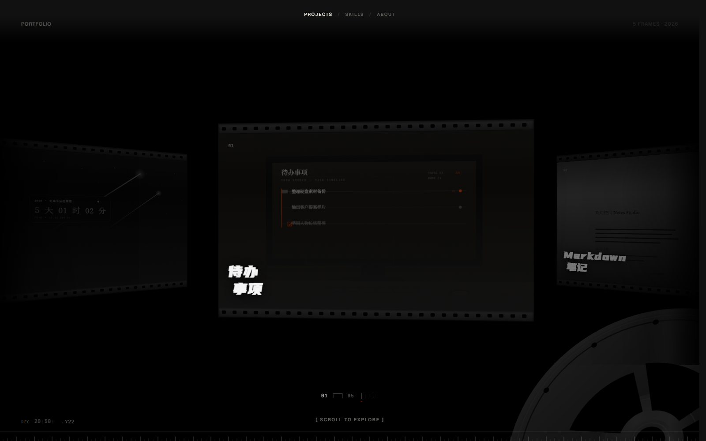
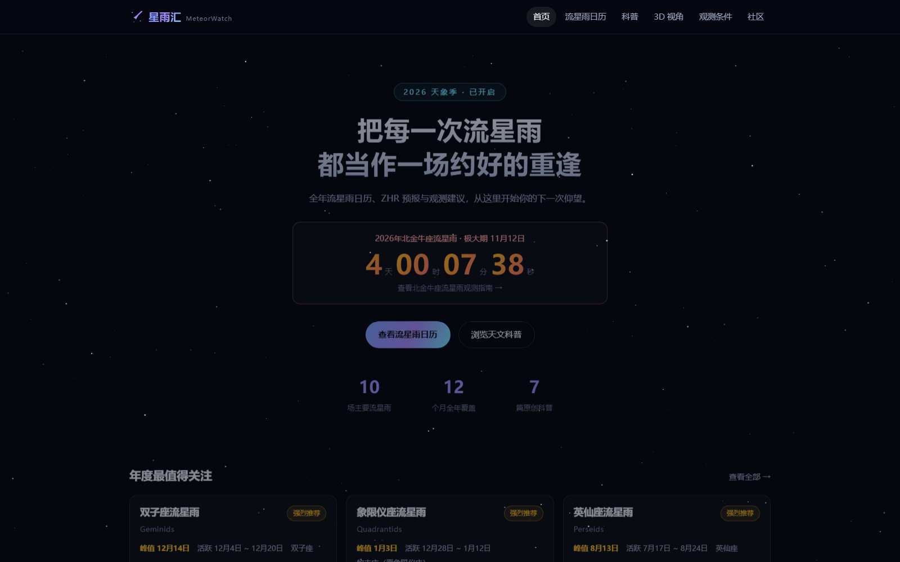
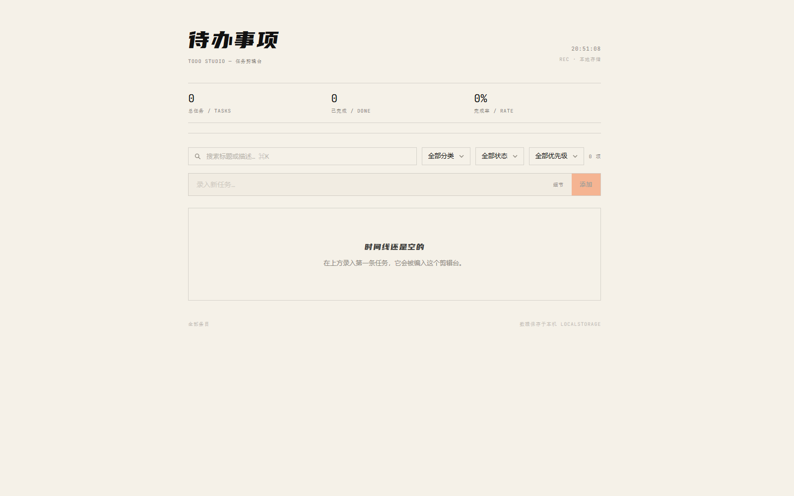
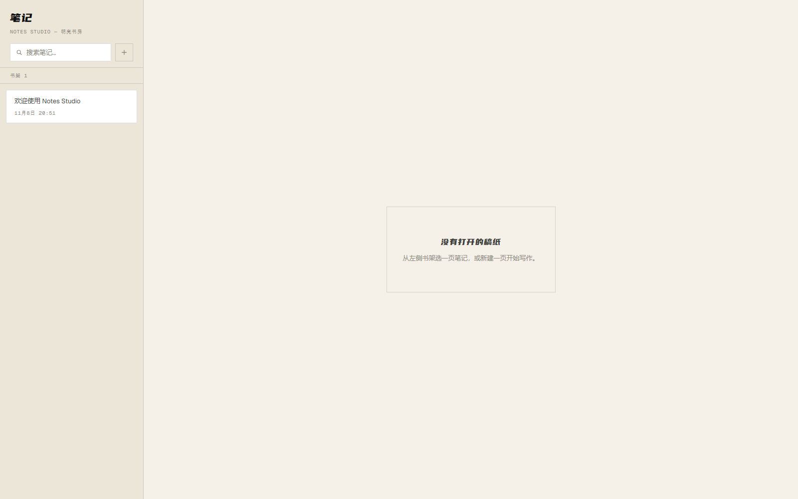
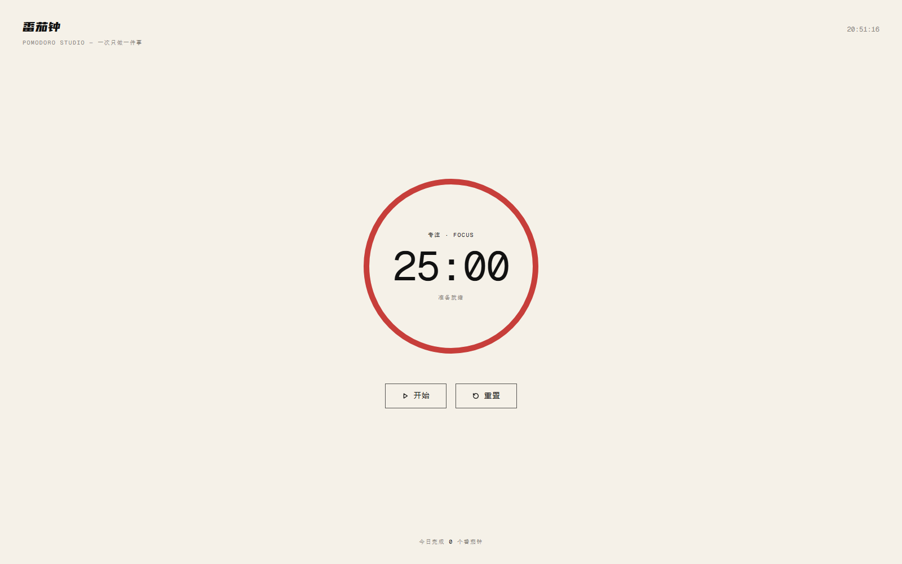
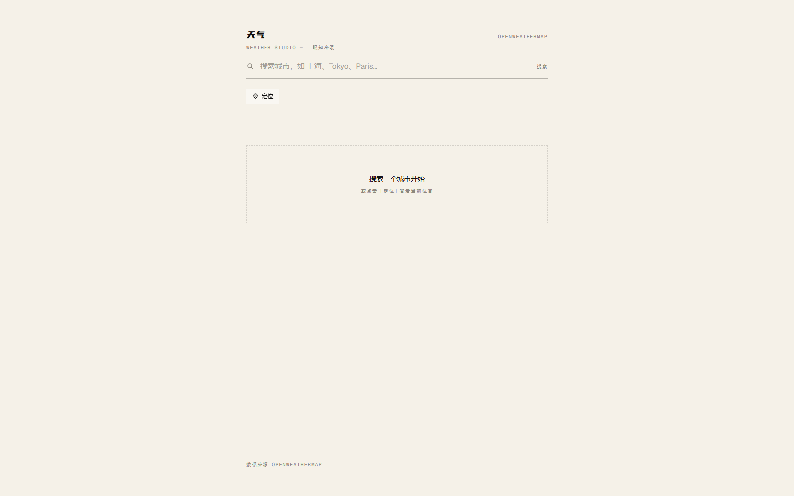

# 个人作品网站 · 胶片带

一个把作品做成胶片带的个人作品集：五个项目按帧排布在一条 3D 胶片带上，左侧贴着镜头、右侧退进深处；滚动即换帧，点开任意一帧会展开「检片台」，陈列大图与项目档案。

**技术栈**：Next.js 16（App Router，静态导出）· TypeScript · Tailwind CSS v4 · GSAP / Flip · GitHub Pages

## 公网访问

| 站点 | 地址 |
| --- | --- |
| 主站 · 作品集 | https://atop49.github.io/portfolio/ |
| 星雨汇 MeteorWatch · 流星雨观测指南 | https://atop49.github.io/meteorwatch/ |
| 待办事项 Todo Studio | https://atop49.github.io/todo-studio/ |
| Markdown 笔记 Notes Studio | https://atop49.github.io/notes-studio/ |
| 番茄钟 Pomodoro Studio | https://atop49.github.io/pomodoro-studio/ |
| 天气 Weather Studio | https://atop49.github.io/weather-studio/ |

## 截图

主站 · 胶片带

星雨汇 MeteorWatch

| 待办事项 | Markdown 笔记 |
| --- | --- |
|  |  |

| 番茄钟 | 天气 |
| --- | --- |
|  |  |