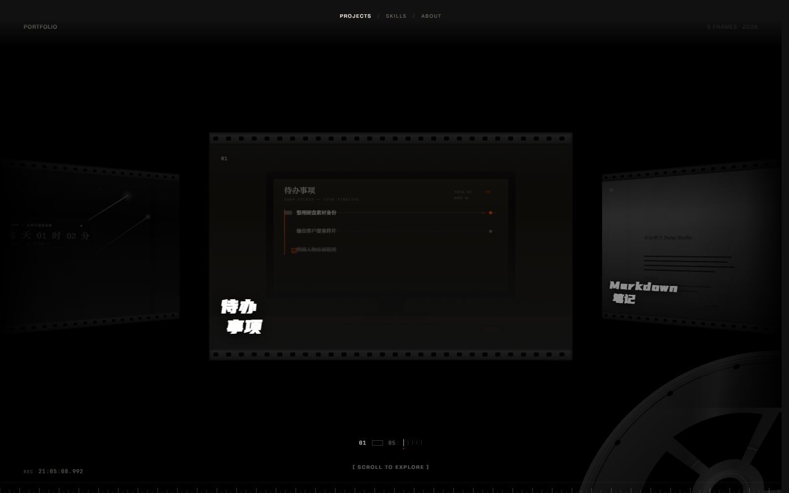
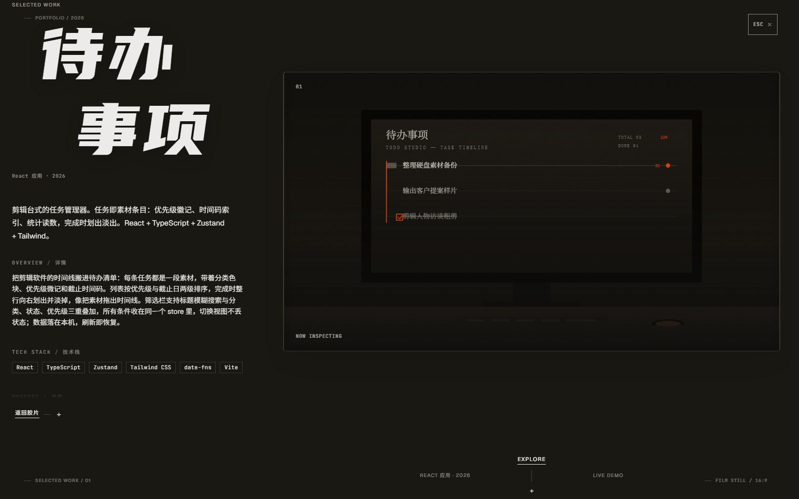
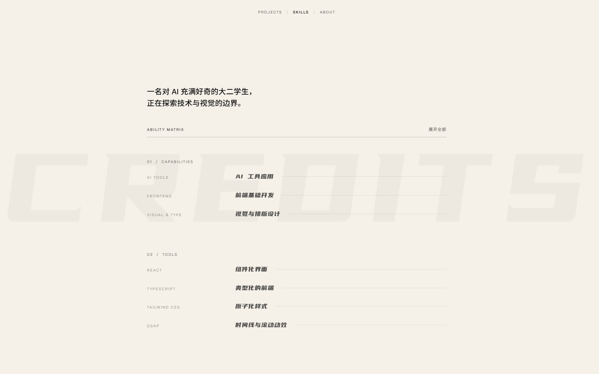
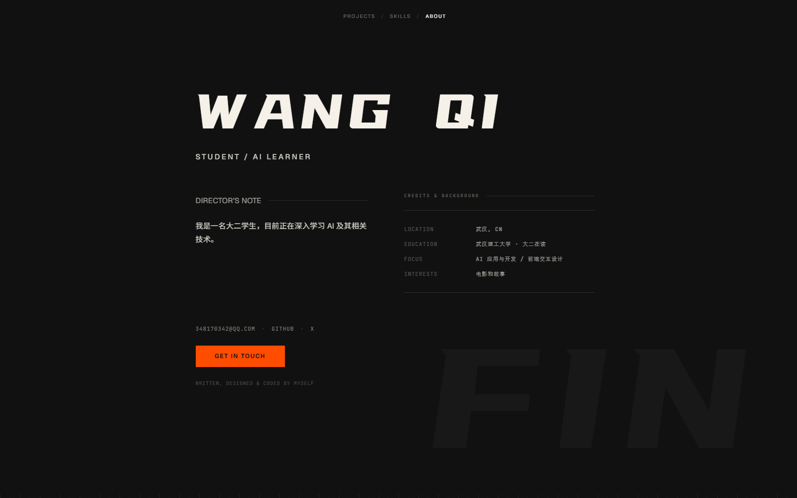

# 个人作品网站

把电影剪辑台的语汇搬进网页：一条可以横着拖动的胶片带，每帧都是一个做过的小项目；框选某一帧，它就"唰"地摊成整幅剧照。

**线上地址：https://atop49.github.io/portfolio/**

技术栈：Next.js（App Router，静态导出）· TypeScript · Tailwind CSS v4 · GSAP / Flip · 自绘 SVG 素材

---

## SELECTED WORK · 胶片带

一条 16:9 的胶片，横向排着 5 帧作品。首屏把中间那张推到眼前，两侧的帧以 45° 向内折过去、去色压暗，越靠右越淡，最后融进黑场。

- **一格一张**：滚轮每滚一格就走一张卡，不再需要连滚好几次；
- **无限循环**：往任一方向拖都不会到头，副本首尾相接，看不见接缝；
- **中心显影**：正中那张是彩色、明亮的，往两侧走会逐帧变成黑白并压暗；鼠标停上去，那一帧会当场"洗"成彩色；
- **刻度与时间码**：底部是 5 格刻度尺（可点，点了直接跳到那一帧），左上角还有滚动的 REC 时间码——整页是"一台在放映的机器"。

## INSPECTOR · 检片台

点任意一帧，卡面会带着翻页动画放大成整幅剧照，左右两侧同时换成"检片台"的版式。

- 左侧是项目档案：一句话简介、**Overview 详情**、**Tech Stack 技术栈**、**Process 制作流程**、**Changelog 更新日志**（目前留空，显示"暂无更新"）；
- 档案区可独立滚动，滚轮在左栏里滚不会带动后面的胶片；
- 右侧剧照跟随鼠标做极轻微的 3D 倾斜，像一张被灯光照到的相纸；
- `ESC` 或「返回胶片」退回胶片带。

## SKILLS · 能力矩阵

按「能力 / 工具 / 协作」三段排的能力清单，左边是栏目编号，右边是名称与一句话说明。默认只显示名称，悬停或点「展开全部」才展开说明——像一份片尾字幕。

## ABOUT · 关于

巨型名字 + 一行身份，下面是导演手记与履历（地点、学校、方向、兴趣），最后是邮箱、GitHub、X 和 Get in touch。

## 全站

- 顶部三个视图（Projects / Skills / About）切换，每个视图有自己的主题底色，切换时整页色调会一起过渡；
- 素材全部是自绘 SVG（每张 1600×900 的"剧照"），没有一张位图；
- 布局与动效都做了降级：窄屏退化成可横滑的平面胶片带，`prefers-reduced-motion` 下关掉位移与倾斜。

---

设计与代码：[atop49](https://github.com/atop49)
